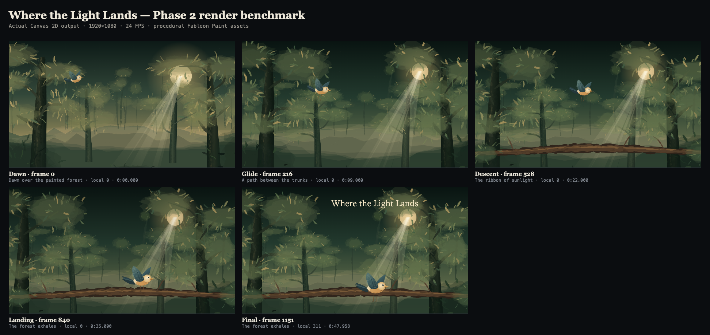
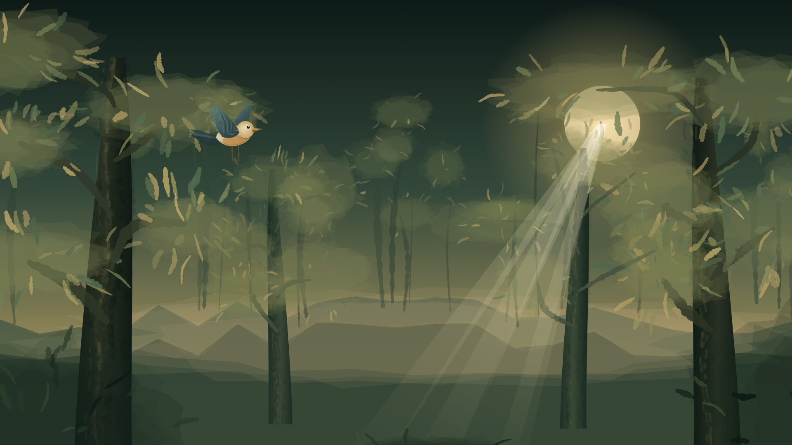
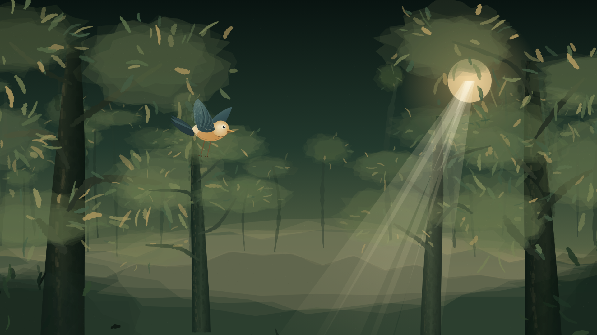
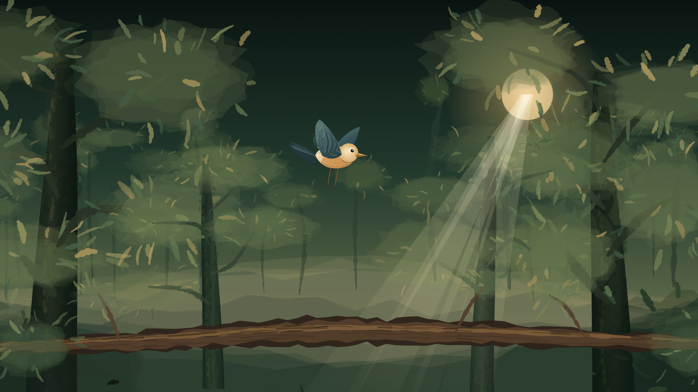
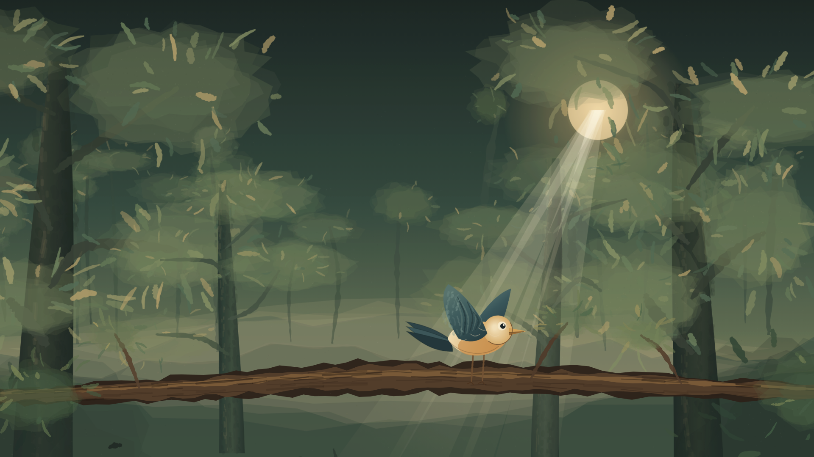
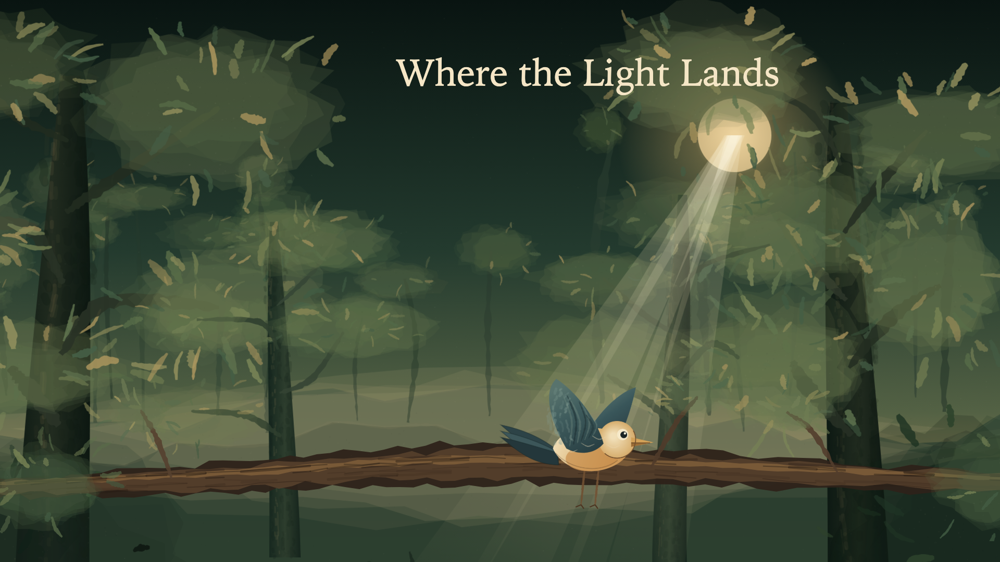

# Phase 2 Completion Report

- **Phase:** 2 — Paint Engine, Real Frame Rendering & Visual Quality Benchmark
- **Date:** 2026-11-09
- **Branch:** `main`
- **Base commit:** `29df7e9` (`docs(report): record phase 1 completion`)
- **Implementation head before this report:** `7c76316`
- **Status:** Engineering complete; artistic quality pending user review
- **Next phase:** Not started

## A. Executive Summary

Phase 2 delivered Fableon's first real rendering path and produced actual
1920×1080 illustrated frames from validated scene data.

What Fableon can now do:

- Validate the Phase 1 project and resolve deterministic `FramePlan`s.
- Paint four procedural benchmark assets (dawn forest, deep forest, branch, and
  bird) using seeded Fableon Paint primitives.
- Compose solid, text, and image layers through a Canvas 2D renderer.
- Resolve safe local PNG assets through a browser-safe, cached loader.
- Preview the benchmark project live in `/studio`.
- Scrub scenes and frames, changing actual canvas pixels through the real
  evaluator.
- Play the timeline using elapsed-time selection at a 24 FPS target, stopping at
  frame 1151.
- Export the current canvas frame as a real 1920×1080 PNG.
- Inspect evaluated layer transforms alongside the rendered image.
- Run committed Playwright checks for pixels, boundaries, playback, export,
  transparency, failure states, mobile layout, and performance.
- Regenerate all benchmark assets and frames from the committed paint code with
  `pnpm benchmark:capture`.

The five required benchmark frames and contact sheet were generated by the real
renderer, not from hand-authored mockups. They are committed under
`docs/benchmarks/phase-02/`.

**Engineering readiness: GO. Artistry: PENDING USER REVIEW.** The result is a
coherent first visual direction, but it is not yet evidence that the fully
procedural paint engine can meet Fableon's final storybook-quality bar.

## B. Initial Repository State

At Phase 2 start:

- Branch `main`, working tree clean.
- HEAD at `29df7e9`, Phase 1's completion report.
- The branch was 8 commits ahead of `origin/main`; no push was performed.
- Existing workspace: pnpm monorepo with `apps/web`, `@fableon/shared`,
  `@fableon/scene-schema`, and `@fableon/animation-core`.
- Existing test suite: 66 passing Vitest tests.
- Existing Studio: read-only timeline inspector with placeholder canvas.
- Existing benchmark project: four scenes, 1152 frames, 1920×1080, 24 FPS.
- Existing image paths were manifest references only; no image files existed.
- Local environment: Node.js `25.9.0`, pnpm `11.1.3`, macOS. CI targets Node 24.
- No uncommitted user work existed at inspection.

New dependency added: `@playwright/test` `1.65.0` plus its local Chromium
browser. No runtime AI, rendering, database, or cloud dependency was added.

## C. Feature Implementation

### Feature 2.1 — Renderer Contract & Canvas Backend

**Commit:** `5bfe8775db7a7bf6557e2e938e3d35c97a3ce2f3`  
**Message:** `feat(render-engine): implement canvas frame renderer`

**Implementation**

- Created `packages/render-engine`.
- Added a strongly typed domain `renderFrame(framePlan, surface, options)` API
  and a browser-facing `renderFrameToCanvas(canvas, framePlan, options)` wrapper.
- Supports solid, text, and image layers.
- Applies explicit stacking order, visibility, translation, rotation, X/Y
  scaling, opacity, and canvas clearing.
- Uses save/restore per layer, pre-resolves visible assets, and explicitly
  rejects missing assets with layer/asset context.
- Documented the version-1 transform convention in code.
- Added `RenderError`, `RenderSurface`, `RasterImage`, and `ImageAssetResolver`
  contracts.

**Files**

- `packages/render-engine/package.json`
- `packages/render-engine/tsconfig.json`
- `packages/render-engine/src/types.ts`
- `packages/render-engine/src/renderer.ts`
- `packages/render-engine/src/renderer.test.ts`
- `packages/render-engine/src/index.ts`
- `pnpm-lock.yaml`

**Tests added:** 11 unit tests covering solid fills, stacking, hidden layers,
transforms, opacity, text, image sizing/deduplication, state isolation, missing
assets, empty plans, clearing, invalid surfaces, and input immutability.

**Acceptance results**

| Criterion                          | Result | Evidence                                          |
| ---------------------------------- | ------ | ------------------------------------------------- |
| Solid/text/asset rendering         | PASS   | Mock command tests and real-browser Studio output |
| Stacking order and visibility      | PASS   | Draw-order and skipped-layer tests                |
| Translation/rotation/scale/opacity | PASS   | Command assertions and browser pixels             |
| Canvas dimensions respected        | PASS   | 1920×1080 surface and exported PNG checks         |
| Missing asset diagnostics          | PASS   | Typed error with layer/asset IDs                  |
| State isolation and clearing       | PASS   | save/restore balance and clearRect tests          |
| FramePlan immutability             | PASS   | Deep-frozen plan test                             |

### Feature 2.2 — Local Asset Resolution

**Commit:** `a369f59dde4c422aec5b7c7c1ee961221e1d4fbd`  
**Message:** `feat(render-engine): add local image asset resolution`

**Implementation**

- Added `createBrowserImageAssetResolver`.
- Resolves manifest IDs to application-relative asset paths only; external
  schemes and unsafe traversal paths are rejected.
- Fetches, validates content type, decodes with `createImageBitmap` (with an
  Image fallback), and preserves native transparency.
- Caches successful decoded images and shares in-flight promises for duplicate
  concurrent requests.
- Evicts failed entries so retries can succeed.
- Supports preload and cache clearing.
- Reports `missing_asset`, `unsupported_asset_type`, `unsafe_asset_path`,
  `fetch_failed`, and `decode_failed` with asset metadata.

**Files**

- `packages/render-engine/src/assets.ts`
- `packages/render-engine/src/assets.test.ts`
- `packages/render-engine/src/index.ts`
- `packages/render-engine/package.json`
- `pnpm-lock.yaml`

**Tests added:** 14 unit tests covering resolution, caching, concurrent
deduplication, base paths, missing/unsupported/unsafe assets, HTTP failures,
decode retries, preloading, cache clearing, external base rejection, and
transparent source preservation. Browser transparency is covered separately.

**Acceptance results**

| Criterion                      | Result | Evidence                                          |
| ------------------------------ | ------ | ------------------------------------------------- |
| Safe relative resolution       | PASS   | Path/base validation tests                        |
| PNG/WebP/browser images        | PASS   | Browser decode of PNG assets; content-type checks |
| Cache and deduplication        | PASS   | Fetch/decode call-count tests                     |
| Missing/failed assets explicit | PASS   | Typed errors and browser UI alert                 |
| Transparency preserved         | PASS   | Real PNG alpha test and visual bird composite     |
| No arbitrary external fetch    | PASS   | Relative base-path enforcement                    |

### Feature 2.3 — Fableon Paint Primitives

**Commit:** `c6026740d3a7ac508af42ef7021f43546f13ba68`  
**Message:** `feat(paint-engine): implement deterministic painterly primitives`

**Implementation**

- Created `packages/paint-engine`.
- Added FNV-1a seed derivation and Mulberry32 PRNG.
- Added Catmull-Rom path sampling, organic tapered ribbon strokes with irregular
  edges, seeded width/opacity/color variation, dry-brush bristle segments with
  gaps, layered wash lobes with granulation, and seeded paper grain.
- Added Canvas render functions for every primitive.
- No paint path calls `Math.random`.
- Stable paint variation derives from a base seed plus stable element
  identifiers, never from frame count or unrelated layer order.
- Benchmark art is baked into PNG assets once rather than repainted every frame.

**Files**

- `packages/paint-engine/package.json`
- `packages/paint-engine/tsconfig.json`
- `packages/paint-engine/src/random.ts`
- `packages/paint-engine/src/color.ts`
- `packages/paint-engine/src/geometry.ts`
- `packages/paint-engine/src/strokes.ts`
- `packages/paint-engine/src/texture.ts`
- `packages/paint-engine/src/index.ts`
- `packages/paint-engine/src/primitives.test.ts`
- `pnpm-lock.yaml`

**Tests added:** 20 unit tests covering deterministic sequences, seed
variation, geometry/color, organic stroke stability and validation, dry-brush
structure/gaps, wash layers/granulation, grain stability/validation, no
unseeded randomness, and mock Canvas commands.

**Acceptance results**

| Criterion                             | Result | Evidence                                      |
| ------------------------------------- | ------ | --------------------------------------------- |
| Same seed → same stroke data          | PASS   | Deep equality tests                           |
| Different seed → controlled variation | PASS   | Comparisons for all primitives                |
| Width/opacity constraints             | PASS   | Validation tests                              |
| No unseeded painting randomness       | PASS   | `Math.random` spy tests                       |
| Real Canvas rendering                 | PASS   | Browser-generated benchmark assets and Studio |
| Stable texture across frames          | PASS   | Baked PNG assets; repeated-frame hash test    |

### Feature 2.4 — First Real Illustrated Benchmark

**Commit:** `4429f22631b8ac000f5529fdb8b90821d3b49db7`  
**Message:** `feat(paint-engine): create painted forest visual benchmark`

**Implementation**

- Added `createWhereTheLightLandsAssets(seed)`.
- Painted a 2048×1152 dawn forest, 2048×1152 deep forest, 2048×360 transparent
  branch, and 720×540 transparent bird.
- Added an internal `/benchmarks/phase-02` capture harness that renders five
  native-resolution frames from the validated project and exposes actual canvas
  data URLs for artifact capture.
- Rendered frames 0, 216, 528, 840, and 1151, plus a five-frame contact sheet.
- Added provenance, asset dimensions, and honest artistic-assessment notes.
- Committed the real PNG assets used by Studio under `apps/web/public/assets/`.

**Files**

- `packages/paint-engine/src/benchmark/where-the-light-lands.ts`
- `packages/paint-engine/src/index.ts`
- `apps/web/app/benchmarks/phase-02/page.tsx`
- `apps/web/app/benchmarks/phase-02/benchmark-harness.tsx`
- `apps/web/public/assets/forest-dawn.png`
- `apps/web/public/assets/forest-deep.png`
- `apps/web/public/assets/branch.png`
- `apps/web/public/assets/bird.png`
- `docs/benchmarks/phase-02/PROVENANCE.md`
- `docs/benchmarks/phase-02/contact-sheet.png`
- five frame PNGs
- `docs/benchmarks/phase-02/render-metrics.json`
- `apps/web/package.json`
- `apps/web/next.config.ts`
- `pnpm-lock.yaml`

**Acceptance results**

| Criterion              | Result | Evidence                                                |
| ---------------------- | ------ | ------------------------------------------------------- |
| Nonempty imagery       | PASS   | Five opaque 1920×1080 PNGs                              |
| Readable environment   | PASS   | Layered painted forest, hill, light, foreground         |
| Recognizable bird      | PASS   | Head/eye/beak/body/wing/tail/legs visible               |
| Scene states differ    | PASS   | Browser hashes differ at frames 0/216/528/840/1151      |
| Layer compositing      | PASS   | Background, branch, bird, and title composite correctly |
| Seeded texture stable  | PASS   | Baked assets and repeat-frame hash                      |
| No hidden asset errors | PASS   | Missing-asset browser test surfaces alert               |
| Actual PNGs exist      | PASS   | Files listed in section G                               |

### Feature 2.5 — Live Canvas Preview in Studio

**Commit:** `898f70545e82f992ff90a4973846278ac6479d29`  
**Message:** `feat(studio): integrate painterly renderer and live preview`

**Implementation**

- Replaced the placeholder canvas with a real 1920×1080 Canvas 2D preview.
- Loads local assets through the browser-safe resolver.
- Renders every selected frame from the real `FramePlan`.
- Adds loading and rendering-error overlays.
- Adds Play/Pause with elapsed-time frame selection at 24 FPS.
- Stops at the final frame and pauses when seeking.
- Adds real current-frame PNG export via `canvas.toBlob`.
- Displays measured last render time and whether it is within the 24 FPS budget.
- Preserves scene selection, layer inspection, transforms, assets, and timeline.
- Updates the homepage and README to Phase 2 status.

**Files**

- `apps/web/app/studio/studio-inspector.tsx`
- `apps/web/app/studio/studio-inspector.test.tsx`
- `apps/web/app/studio/page.tsx`
- `apps/web/app/studio/page.test.tsx`
- `apps/web/app/page.tsx`
- `apps/web/app/page.test.tsx`
- `apps/web/components/pipeline-overview.tsx`
- `apps/web/components/site-footer.tsx`
- `apps/web/components/site-header.tsx`
- `packages/shared/src/brand.ts`
- `README.md`

**Tests added/updated**

- 7 Studio inspector component tests (render-ready state, evaluator integration,
  scrubbing, scene boundaries, playback controls, final title state, and visible
  renderer/asset errors).
- 3 Studio page tests updated for the live preview shell.
- Existing Phase 0/1 tests remain passing.

**Acceptance results**

| Criterion                        | Result | Evidence                                     |
| -------------------------------- | ------ | -------------------------------------------- |
| Scrubbing changes rendered frame | PASS   | Component and browser tests                  |
| Scene selection updates preview  | PASS   | Browser boundary tests                       |
| Play/pause and final stop        | PASS   | Browser test reaches frame 1151 and stops    |
| PNG export                       | PASS   | Download parsed as 1920×1080 PNG             |
| Asset errors visible             | PASS   | 404 route interception test                  |
| Inspector preserved              | PASS   | Layer transforms/selection tests still pass  |
| Responsive preview               | PASS   | Mobile viewport test, no horizontal overflow |

### Feature 2.6 — Browser Testing & Visual Evidence

**Commit:** `39be578e9ac10fc7e0035aa764a852c73bc3c687`  
**Message:** `test(rendering): add browser and visual regression checks`

**Implementation**

- Added Playwright `1.65.0`, config, TypeScript config, and nine browser tests.
- Added canvas pixel hashing and unique-color assertions.
- Added within-environment repeatability checks, frame-difference checks, scene
  boundaries, playback, export dimensions, transparency, loading/error states,
  mobile layout, and performance measurement.
- Added `scripts/capture-phase-02.mjs` for reproducible benchmark asset/frame
  capture.
- Added browser performance evidence.
- Extended CI with Playwright browser installation and browser tests.
- CI remains unexecuted remotely; no remote pass is claimed.

**Files**

- `playwright.config.ts`
- `tsconfig.playwright.json`
- `tests/browser/helpers.ts`
- `tests/browser/studio.spec.ts`
- `tests/browser/performance.spec.ts`
- `scripts/capture-phase-02.mjs`
- `docs/benchmarks/phase-02/browser-performance.json`
- `.github/workflows/ci.yml`
- `.gitignore`
- `package.json`
- `pnpm-lock.yaml`
- `README.md`

**Tests added:** 9 Playwright tests.

### Corrective Commit — Branch Transparency

**Commit:** `7c76316a8a5fb3c8316507fc065641aea743d92e`  
**Message:** `fix(paint-engine): preserve branch transparency in benchmark art`

- Found during visual review: paper grain was being painted across the branch
  asset's transparent background.
- Applied grain with `source-atop` so only painted branch pixels receive it.
- Regenerated the branch asset, affected frames, contact sheet, and metrics.
- Re-ran the full validation suite.

## D. Rendering Architecture

### Contracts

```ts
renderFrame(framePlan, renderSurface, { assets, clear? }): Promise<RenderFrameResult>
renderFrameToCanvas(canvas, framePlan, { assets, width?, height?, clear? }): Promise<RenderFrameResult>
```

`RenderSurface` contains a Canvas 2D context and positive integer dimensions.
`ImageAssetResolver` returns a decoded `RasterImage` with intrinsic width/height.
The renderer is asynchronous only because asset resolution is asynchronous; all
drawing is synchronous Canvas 2D.

### Consumption of FramePlan

The renderer consumes `FramePlan.layers` in the order produced by
`animation-core` (ascending explicit `order`). It never reads keyframes or
reimplements evaluation. It resolves all visible image assets before drawing, so
a missing asset fails before a partial composition is presented. The
`FramePlan` is treated as immutable.

### Transform convention

- Canvas origin: top-left; X right, Y down.
- Layer `x`/`y`: top-left of local content.
- Version 1 transform origin and rotation pivot: top-left of content. There is
  no anchor field in schema version 1.
- Operation order: translate → rotate → scale → draw content at local (0, 0).
- Rotation units: degrees.
- Opacity: multiplied into `globalAlpha` with normal source-over compositing.
- Solid: fills the full render surface at local size.
- Image: drawn at intrinsic pixel dimensions; scene clipping crops overdraw.
- Text: top-left baseline, declared font size, newline line-height 1.2; no
  wrapping or rich text.
- Hidden layers are skipped and reported separately.
- The canvas is cleared before rendering by default.
- Save/restore wraps clearing, the layer loop, and each layer.

### Version-1 limitations

- No anchor/registration point means rotations and scales pivot at top-left.
- Solid layers have no independent width/height; they fill the canvas.
- Image layers have no fit/crop field; native image size is the v1 convention.
- No masks, blend modes, groups, or clipping.
- No video asset rendering; video/audio references are not drawn.
- Font metrics depend on system fonts and browser text shaping.

## E. Paint Engine

### Stroke algorithms

1. **Organic stroke:** Catmull-Rom path sampling; tapered width envelope;
   seeded width noise; offset left/right edges for irregular contours; seeded
   palette variation toward light/dark pigment; filled ribbon.
2. **Dry brush:** multiple bristles distributed across the stroke width; each
   bristle follows the curve with directional jitter and is broken into segments
   by seeded gaps. This creates directional texture rather than random dots.
3. **Wash:** layered irregular radial blobs with per-lobe offset, size, color,
   and alpha; seeded granulation specks inside the ellipse. It intentionally
   approximates translucent pigment, not fluid simulation.
4. **Paper grain:** seeded light/dark specks with density, size, and alpha
   controls. Grain is applied only to painted pixels for transparent assets.

### Seed behavior

- FNV-1a hashes stable string/number parts into a 32-bit seed.
- Mulberry32 generates deterministic values from that seed.
- Derived seeds use project seed + stable scene/layer/element identifiers.
- The paint path uses no `Math.random`; a test spies on it.
- Baked assets do not regenerate between frames.

### Caching and performance

- Procedural assets are painted once and committed as PNGs; frame rendering only
  composites cached decoded images.
- The asset loader caches decoded images by asset ID and deduplicates concurrent
  loads.
- No paint primitive runs during ordinary frame playback.
- The internal benchmark harness caches its generated asset set for the session.
- A future production paint engine will need a real raster/layer cache; Phase 2
  uses baked assets as the stable cache boundary.

### Known limitations

- No wet-media simulation, pigment diffusion, granulation physics, or
  resolution-independent stroke replay.
- Foliage strokes are generated individually and can read as floating dashes.
- Brush shapes lack the variety of a production brush library.
- Character art is a single static illustration, not a rigged/articulated form.
- No cross-browser pixel-identity guarantee; Chrome output is the verified
  environment.

## F. Asset System

### Resolution flow

```text
validated project.assets[]
  -> asset ID map
  -> safe relative path validation
  -> application-relative URL
  -> fetch
  -> content-type check
  -> createImageBitmap (or Image fallback)
  -> RasterImage cache
```

- Base path must be application-relative; external schemes and `//` hosts are
  rejected.
- Only image asset types can be visually resolved. Audio entries remain valid
  manifest entries but are not rendered.
- Successful decoded images are cached by ID.
- Concurrent duplicate requests share one in-flight promise.
- Failed loads are evicted so retries can occur.
- Errors carry code, asset ID, path, HTTP status where available.

### Actual assets

| Asset ID          | File                                     | Dimensions | Provenance                                        |
| ----------------- | ---------------------------------------- | ---------- | ------------------------------------------------- |
| `forest-dawn`     | `apps/web/public/assets/forest-dawn.png` | 2048×1152  | Procedural Fableon Paint + Canvas 2D              |
| `forest-deep`     | `apps/web/public/assets/forest-deep.png` | 2048×1152  | Procedural Fableon Paint + Canvas 2D              |
| `branch`          | `apps/web/public/assets/branch.png`      | 2048×360   | Procedural Fableon Paint + Canvas 2D, transparent |
| `bird`            | `apps/web/public/assets/bird.png`        | 720×540    | Procedural Fableon Paint + Canvas 2D, transparent |
| `forest-ambience` | manifest only                            | —          | No audio file; not rendered                       |

No external artwork, photographs, GIFs, model outputs, or licensed media are
used. The only typography is the Canvas text layer using system serif fonts.
See `docs/benchmarks/phase-02/PROVENANCE.md` for full provenance and licensing
notes.

## G. Visual Benchmark

### Artifacts

- Contact sheet: [`docs/benchmarks/phase-02/contact-sheet.png`](../benchmarks/phase-02/contact-sheet.png)
- Frame 0: [`frame-0000-dawn.png`](../benchmarks/phase-02/frame-0000-dawn.png)
- Frame 216: [`frame-0216-glide.png`](../benchmarks/phase-02/frame-0216-glide.png)
- Frame 528: [`frame-0528-descent.png`](../benchmarks/phase-02/frame-0528-descent.png)
- Frame 840: [`frame-0840-landing.png`](../benchmarks/phase-02/frame-0840-landing.png)
- Frame 1151: [`frame-1151-final.png`](../benchmarks/phase-02/frame-1151-final.png)
- Render metrics: [`render-metrics.json`](../benchmarks/phase-02/render-metrics.json)
- Browser performance: [`browser-performance.json`](../benchmarks/phase-02/browser-performance.json)
- Provenance: [`PROVENANCE.md`](../benchmarks/phase-02/PROVENANCE.md)













### How the images were created

- `createWhereTheLightLandsAssets(20261109)` paints four transparent/opaque
  raster assets using Fableon Paint primitives plus Canvas 2D gradients, Bézier
  paths, arcs, and fills for base forms and lighting.
- The internal `/benchmarks/phase-02` harness resolves those canvases directly
  as image assets, evaluates frames 0/216/528/840/1151, and renders native
  1920×1080 canvases through `@fableon/render-engine`.
- The harness exposes actual `canvas.toDataURL("image/png")` outputs.
- `scripts/capture-phase-02.mjs` writes the assets, five frame PNGs, contact
  sheet, and render metrics into the repository.
- Studio loads the committed PNG assets through the browser-safe resolver; it
  does not depend on the harness at runtime.

### Objective technical assessment

- All five frames are nonempty, opaque 1920×1080 PNGs.
- The bird, branch, forest layers, light shafts, and title composite in the
  expected stacking order.
- Frames differ where animation data differs; repeated frame rendering hashes
  identically in the same browser session.
- The bird asset has both fully transparent and painted-alpha pixels.
- The branch asset preserves transparency outside its painted branch/twigs.
- No missing-asset error is hidden; a 404 test produces a visible alert.
- The title appears only when its opacity animation reaches visibility.

### Subjective artistic assessment

**Strengths**

- The olive/ochre palette is cohesive and has a clear warm focal light.
- The layered forest, mist, distant trees, and foreground foliage create real
  depth.
- The bird reads as a bird, with a distinct eye, beak, body, wing, tail, and
  legs; it contrasts well against the forest.
- The light shafts and paper grain give a storybook atmosphere.
- The landing composition, with the bird on the branch under the light, is the
  strongest frame.

**Weaknesses**

- Many leaf marks read as detached dashes; foliage needs more clustered, varied
  leaf construction.
- Trunk shading is flat in places, and some crown/trunk edges look blocky at
  native resolution.
- The branch reads more like a log than an elegant storybook branch.
- The bird is one static illustration; it does not articulate wings or body
  through flight/landing.
- Scenes 2–4 reuse the same forest plate; visual variety relies on transforms,
  bird position, and the branch entrance.
- The title is typographic, not painted lettering.
- Texture is present but subtle; it is not yet convincing wet/gouache media.
- The overall result is a credible first illustrated direction, not final
  production quality.

**Artistic readiness: PENDING USER REVIEW.** No visual-quality PASS is claimed.

## H. Tests and Performance

### Automated tests

- **112 Vitest unit tests** across 12 files.
- **9 Playwright browser tests.**
- **121 total automated tests.**
- Phase 1 had 66 unit tests; all prior tests remain passing or were updated for
  the live preview. Phase 2 added 46 unit tests and 9 browser tests.

New unit coverage:

- 11 renderer tests.
- 14 asset-resolver tests.
- 20 paint-primitive tests.
- 1 additional Studio component test (plus updated page/inspector assertions).

Browser coverage:

- populated 1920×1080 canvas and pixel hash;
- repeat-frame stability;
- distinct frame output;
- next/previous/scene boundary controls;
- elapsed-time playback and final-frame stop;
- PNG export dimension validation;
- bird transparency;
- delayed asset loading state;
- missing asset alert;
- mobile layout without horizontal overflow;
- performance measurement.

### Verification results

| Check            | Result     | Evidence                                                                                             |
| ---------------- | ---------- | ---------------------------------------------------------------------------------------------------- |
| Installation     | PASS       | `pnpm install` — 7 workspace projects, up to date; frozen install previously passed                  |
| Formatting       | PASS       | `pnpm format:check` — all matched files formatted                                                    |
| Lint             | PASS       | `pnpm lint` — `eslint . --max-warnings=0`                                                            |
| TypeScript       | PASS       | `pnpm typecheck` — Playwright config/tests + 6 package targets, strict `tsc --noEmit`                |
| Unit tests       | PASS       | `pnpm test` — 12 files, 112 tests, 4.64s                                                             |
| Production build | PASS       | `pnpm build` — Next.js 16.4.5, static routes including `/studio` and `/benchmarks/phase-02`          |
| Browser tests    | PASS       | `pnpm test:browser` — 9/9 passed in Chromium 158.0.8127.18                                           |
| Runtime routes   | PASS       | Production server: `/` 200, `/studio` 200, `/benchmarks/phase-02` 200, `/assets/forest-dawn.png` 200 |
| CI workflow      | CONFIGURED | Playwright install and browser tests added; remote GitHub execution not performed                    |

### Benchmark rendering performance

Native renderer measurements from the harness (`render-metrics.json`):

- Asset generation: **31 ms** for four painted canvases.
- Frame 0 render: **4.1 ms**.
- Frame 216: **1.2 ms**.
- Frame 528: **0.8 ms**.
- Frame 840: **2.4 ms**.
- Frame 1151: **0.9 ms**.
- Total harness generation including PNG encoding: **598.8 ms**.

These render times use generated in-memory canvases, so they exclude browser
network fetch/decode. They measure actual Canvas 2D composition, not PNG
encoding. Total generation includes exporting data URLs.

### Studio/browser performance

Measured on Apple M1, macOS 25.5.0, Chromium 158.0.8127.18, Playwright 1.65.0,
1440×1000 UI with a native 1920×1080 canvas:

- First frame ready after navigation: **472 ms**.
- First frame render (including fetch/decode): **42.7 ms** — slightly over the
  41.7 ms one-frame 24 FPS budget.
- Initial asset timing: **2 requests, ~7 ms resource-timing span, 1.92 MB**.
- Cached frame samples: `[42.7, 0.1, 0.1, 0, 0, 0, 0.1, 0.1, 0, 34.5]` ms.
- Cached median: **0.1 ms**; cached p95: **42.7 ms** (dominated by the initial
  sample retained in the set).
- Approximate playback throughput: **22.1 frames / second** over 1.132 s (25
  frames advanced from frame 0).
- JS heap before/after: **20.5 MB / 20.5 MB** by Chrome’s rounded
  `performance.memory` snapshot. This is not a full GPU/canvas memory measure.

The rendered frame stream is deterministic and responsive for cached frames, but
playback is slightly below the 24 FPS target in this headless run. The Studio
reports actual render time; it does not claim smooth playback.

### Reproducibility limitations

- No committed cross-platform screenshot baseline. Canvas text shaping, font
  fallback, and rasterization differ by browser/OS/GPU. Tests use exact
  within-session hashes and visible-difference assertions; the committed PNGs
  are the human-review baseline.
- Browser metrics are hardware/browser/session-specific.
- CI browser execution was configured but not run remotely.
- The harness capture was run locally with Playwright Chromium, not through CI.

## I. Known Problems

### Artistic shortcomings

- Foliage repetition and floating dash-like marks.
- Blocky/flat trunk shading and occasional hard crown edges.
- Branch silhouette reads as a log.
- Static bird across all scenes; no wing/body articulation.
- Reused forest plate in scenes 2–4.
- Simple typographic title rather than painted lettering.
- Grain is subtle; not yet a distinctive painted surface.
- Overall visual quality is suitable for a first direction, not final delivery.

### Rendering and data limitations

- Version-1 layers rotate/scale about the top-left because the schema has no
  anchor. This is documented, but limits camera-like composition.
- Solid layers fill the entire surface; image layers use intrinsic dimensions.
- No blend modes, masks, groups, clipping, video layers, or audio rendering.
- No paint layer cache; baked PNGs and decoded-image cache are the current
  stability/performance boundary.
- The benchmark uses 2048×1152 forest plates for overdraw; larger assets suit the
  Phase 1 transform data but add memory.

### Performance / brittleness

- First Studio frame in the performance run was 42.7 ms, just over the 24 FPS
  frame budget.
- Playback measured 22.1 FPS rather than 24 FPS. If this persists on target
  hardware, Phase 3 should profile draw calls and consider a canvas/offscreen
  layer strategy.
- Cached p95 is pulled up by the initial/first-scene sample; median is
  sub-millisecond but the sample is small.
- No cross-browser pixel identity is claimed.
- Browser CI installs Chromium with system dependencies; remote reliability is
  not yet proven.

### Scope deviations / unresolved questions

- The Phase 2 roadmap mentioned evaluating `p5.brush` and `animate`; this phase
  did not integrate or compare those libraries. The custom primitives were
  prioritized as requested by the phase prompt. p5.brush remains a future
  comparison candidate.
- The roadmap mentioned a paint layer cache; Phase 2 instead bakes procedural
  artwork once into stable PNG assets and caches decoded images. A true paint
  layer cache is deferred.
- The bird is a single illustrated asset, not a rig; wing articulation and
  character motion are Phase 3.
- No audio file exists for the valid audio manifest entry; audio is out of
  scope.
- The internal benchmark harness route is committed for reproducibility and is
  not linked from product navigation.

### Decisions requested from the user

**Engineering readiness: GO.**

**Artistic readiness: PENDING USER REVIEW.**

Recommended Phase 3 direction: **hybrid asset-plus-paint**.

The procedural environment establishes a usable deterministic base and a
consistent palette, but the character/detail quality is the current limiting
factor. A hybrid approach can retain Fableon Paint for backgrounds, texture,
light, and procedural atmosphere, while using authored or generated illustrated
assets for the bird and key foreground elements. The renderer already composes
image layers with deterministic transforms, so this recommendation does not
require a schema change. A fully procedural character pipeline should not be
treated as validated by this benchmark.

## Running the Studio preview

```bash
corepack enable
pnpm install
pnpm dev
```

Open [http://localhost:3000/studio](http://localhost:3000/studio). Use the scene
list, global frame slider, Previous/Next scene controls, Play/Pause, layer
selection, and Export PNG. The benchmark harness is available internally at
[http://localhost:3000/benchmarks/phase-02](http://localhost:3000/benchmarks/phase-02).

Browser tests:

```bash
pnpm exec playwright install chromium
pnpm test:browser
```

Regenerate benchmark assets and frames:

```bash
pnpm benchmark:capture
```
