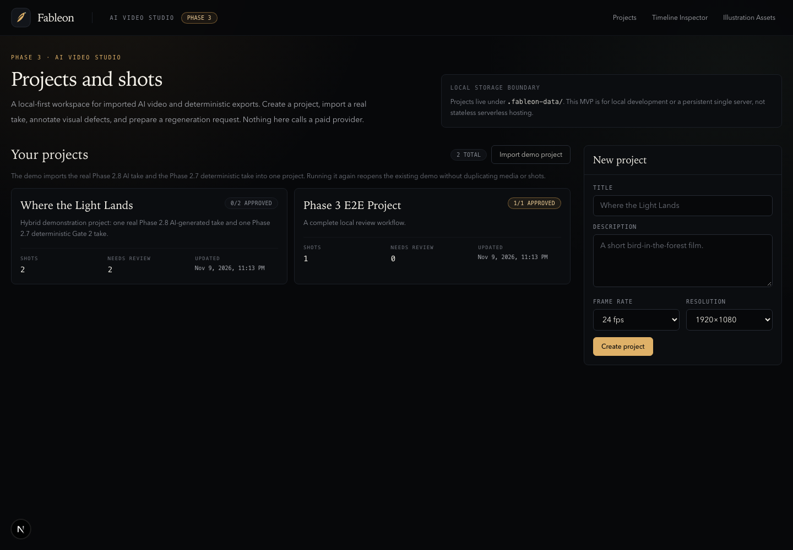
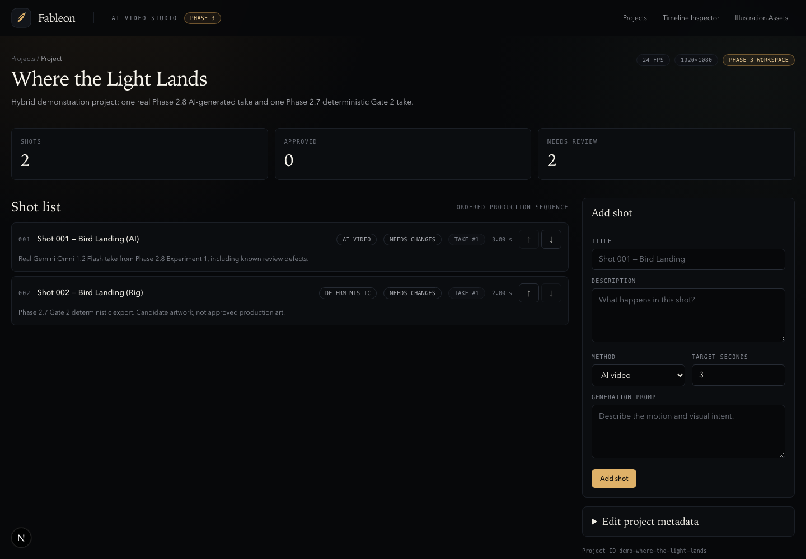
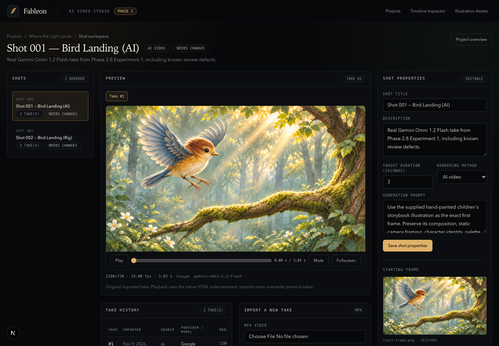
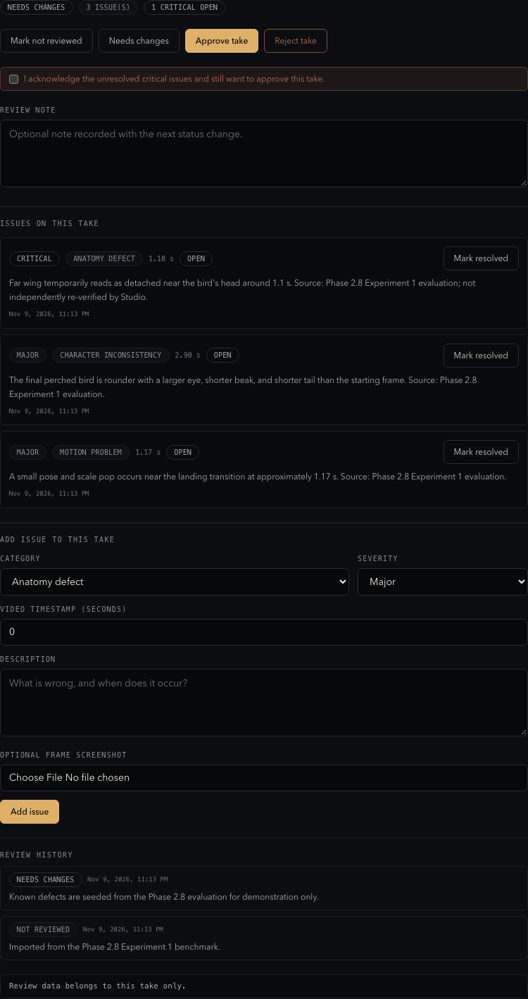
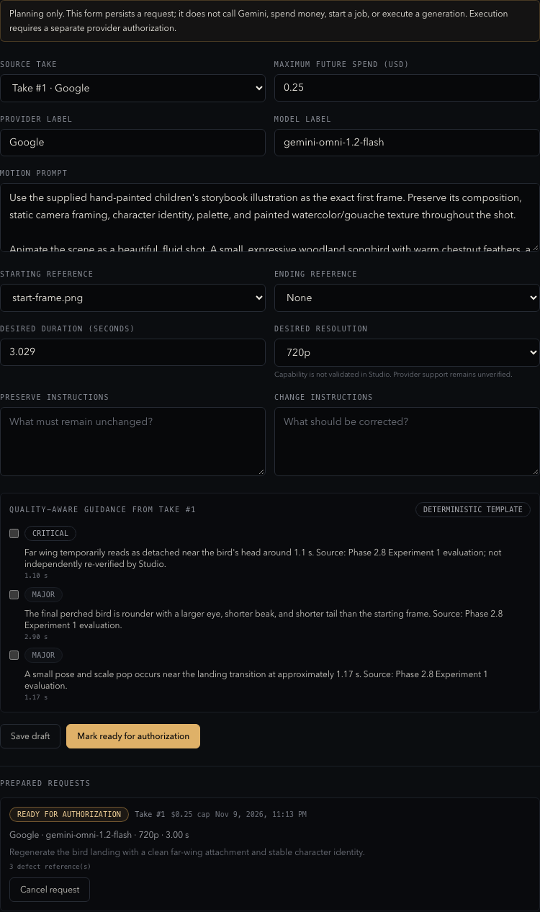
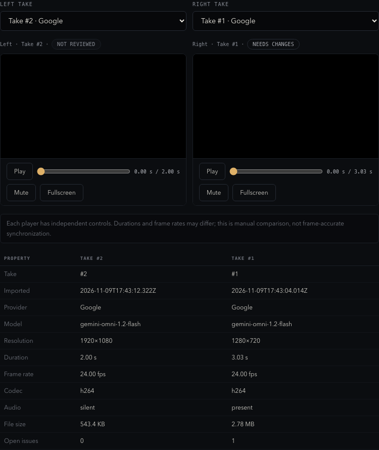

# Phase 3 Report — AI Video Studio MVP

- **Phase:** 3 — Shot management, visual review, and regeneration planning
- **Date:** 2026-11-09
- **Branch:** `main`
- **Starting HEAD:** `37166c8`
- **Final implementation HEAD before this report:** `3d39c4c`
- **Report commit:** the commit containing this report
- **Status:** **COMPLETE — LOCAL AI VIDEO WORKSPACE OPERATIONAL**
- **Paid provider calls:** **0**
- **Remote push:** **None**

## A. Executive Summary

Fableon is now a usable local workspace for managing and improving animated
shots, not just a collection of benchmark pages.

A user can genuinely:

1. Create and reopen a local animation project.
2. Add AI-video and deterministic shots in any order.
3. Import real MP4 files as immutable takes.
4. Attach a PNG/JPEG/WebP starting reference.
5. Preview and scrub the video with native playback.
6. Inspect resolution, duration, frame rate, codec, audio presence, file size,
   SHA-256, provider, model, and import time.
7. Record take-specific visual defects with category, severity, timestamp,
   description, optional screenshot, and resolution state.
8. Set a take to Not reviewed, Needs changes, Approved, or Rejected.
9. Compare two takes side by side with independent video players and metadata.
10. Prepare a durable regeneration request with defect-linked guidance and a
    future spending ceiling.
11. Reload the page, restart the server, and recover the saved project, media,
    review state, issues, and regeneration request.

The Phase 2.8 AI MP4 and the Phase 2.7 deterministic MP4 are imported into a
real demonstration project. No fake video or fabricated provider result was
created. Phase 3 performs **no paid generation**.

## B. Initial Repository State

- **Branch:** `main`
- **Starting HEAD:** `37166c8` — Phase 2.8 Experiment 2 blocker report
- **Working tree at start:** clean
- **Package manager:** pnpm 11.1.3
- **Node baseline:** Node 22.13+ or 24+
- **Existing preserved systems:** Phase 0–2.8 renderer, scene schema,
  animation core, paint/render engines, illustration pipeline, benchmark
  routes, and all historical benchmark artifacts.
- **Final implementation HEAD before report:** `3d39c4c`
- **Final working tree:** clean after the report commit

No scene-schema contract was changed. No historical benchmark output was
modified or deleted.

## C. Completed Features

### 3.1 Persistent local project and shot storage

- **Commit:** `cff7f7e` — `feat(studio): add persistent local project and shot storage`
- **Implementation:** versioned Studio project/shot/take/media/review/
  regeneration contracts; strict read/write validation; atomic JSON writes;
  per-project write locks; safe entity IDs; filesystem repository; corrupted
  manifests fail explicitly.
- **Primary files:** `apps/web/lib/studio/types.ts`,
  `validation.ts`, `repository.ts`, `model.ts`, `errors.ts`,
  `repository.test.ts`, `.gitignore`.
- **Tests added:** 8 storage tests covering create/read, reorder, takes, issues,
  critical-approval protection, duplicate take conflict, path traversal,
  corrupted manifests, metadata and summaries.
- **Acceptance:** storage survives re-reads; tests use isolated temporary
  directories; real `.fableon-data/` is ignored.

### 3.2 Local video import and metadata inspection

- **Commit:** `22cd867` — `feat(media): implement local video import and metadata inspection`
- **Implementation:** MP4 magic-byte validation; PNG/JPEG/WebP magic-byte
  validation; FFprobe metadata; SHA-256 hashing; immutable media copies;
  duplicate media reuse; upload-size limits; safe media paths; range-request
  parsing; constrained media route; image-upload and take-upload routes.
- **Primary files:** `apps/web/lib/studio/media.ts`, `media.test.ts`,
  `http.ts`, `apps/web/app/api/studio/media/[mediaId]/route.ts`,
  `.../projects/[projectId]/media/route.ts`,
  `.../shots/[shotId]/takes/route.ts`.
- **Tests added:** 8 media tests covering the real Phase 2.8 MP4, PNG import,
  invalid file rejection, size limits, duplicate reuse, not-found/error paths,
  and byte-range parsing.
- **Acceptance:** real MP4 imports as 1280×720, 3.029 s, 24 fps, H.264 with
  audio; source hash remains unchanged; range request returns HTTP 206.

### 3.3 Functional AI video shot workspace

- **Commit:** `4792990` — `feat(studio): create functional ai video shot workspace`
- **Implementation:** `/studio/projects` dashboard; project page with ordered
  shot list, shot creation, reorder controls, and metadata editing; shot
  workspace with shot list, native video preview, play/pause, scrub, time,
  mute, fullscreen, take selector, import form, take history, shot properties,
  reference-image upload, and read-only take metadata.
- **Primary files:** Studio project pages, `projects-dashboard.tsx`,
  `project-workspace.tsx`, `shot-workspace.tsx`, `video-preview.tsx`,
  `take-import-form.tsx`, `take-history.tsx`, `shot-properties.tsx`,
  project/shot API routes.
- **Acceptance:** a user can create a project, add a shot, import a real MP4,
  preview it, scrub it, and recover it after reload.

### 3.4 Shot review and take comparison

- **Commit:** `83d515c` — `feat(review): add shot quality control and take comparison`
- **Implementation:** take-specific review statuses; review history; issue
  categories/severities/timestamps; issue create/resolve/reopen; optional issue
  screenshot upload; critical-issue approval acknowledgement; side-by-side
  take comparison with independent players and metadata table.
- **Primary files:** `review-panel.tsx`, `comparison-panel.tsx`, review and
  issue API routes, status badges, repository tests.
- **Tests added:** take-specific review independence and issue resolution tests.
- **Acceptance:** approving Take 2 does not approve Take 1; switching takes
  restores their separate issues and status; unresolved critical issues require
  explicit acknowledgement before approval.

### 3.5 Persistent regeneration request planning

- **Commit:** `d1ac1a7` — `feat(generation): add persistent regeneration request planning`
- **Implementation:** source take selection; provider/model labels; motion
  prompt; start/end reference image selection; desired duration and resolution;
  preserve/change instructions; defect references; future budget ceiling;
  Draft / Ready for authorization / Cancelled statuses; deterministic
  defect-to-guidance template; no provider call.
- **Primary files:** `regeneration-panel.tsx`, regeneration API routes,
  `model.ts` guidance templates, repository tests.
- **Tests added:** request persistence, defect references, status transitions.
- **Acceptance:** request survives reload; status can move draft → ready or be
  cancelled; no network request is made to a video provider.

### 3.6 Hybrid AI and deterministic shot support

- **Commit:** `ded1605` — `feat(studio): support ai and deterministic shot sources`
- **Implementation:** `renderingMethod` AI-video/deterministic; take source
  types AI-video/deterministic-export/imported-video; shared project model;
  method badges; method-specific default import source.
- **Tests added:** one project stores both methods, separate takes, and separate
  reviews.
- **Acceptance:** the Studio can inspect an AI take and a deterministic Gate 2
  take in the same project.

### 3.7 End-to-end production workflow coverage

- **Commit:** `966f0f4` — `test(studio): add end-to-end ai video production workflow coverage`
- **Implementation:** isolated Playwright storage under
  `.fableon-data/playwright`; full workflow test; real MP4 uploads; native
  playback/seeking; issue creation; needs-changes review; regeneration
  planning; second take; comparison; approval; reload persistence; direct
  byte-range check; screenshot capture.
- **Primary files:** `tests/browser/studio-workflow.spec.ts`,
  `playwright.config.ts`, screenshot evidence.
- **Tests added:** 2 browser tests.
- **Acceptance:** the complete workflow passes with real media, and provider
  network interception records zero paid-generation requests.

### 3.8 Real demonstration project

- **Commit:** `0d6bd7b` — `feat(demo): add real fableon animation project`
- **Implementation:** explicit idempotent demo importer; real Phase 2.8 AI MP4;
  real Phase 2.7 deterministic MP4; start frame; deterministic frame; grounded
  review issues; prepared regeneration request.
- **Primary files:** `apps/web/lib/studio/demo.ts`, `demo.test.ts`,
  `apps/web/app/api/studio/demo/route.ts`, Projects dashboard button.
- **Tests added:** real media/metadata assertions and repeated-import
  idempotence.
- **Acceptance:** demo import creates 2 shots, 4 media assets, 2 takes, 4
  review issues, and 1 regeneration request; second import creates no
  duplicates.

### Documentation and corrective commits

- `5b7669d` — `style(studio): format studio request helpers`
- `10fccd3` — `fix(media): scope runtime media paths out of build tracing`
- `3d39c4c` — `docs(studio): document phase 3 local workspace`
- Report commit — `docs(report): record phase 3 completion`

## D. Architecture

### Domain relationships

```text
StudioProject
├── shotOrder[] ────────────── orders shots without changing IDs
├── shots[]
│   └── StudioShot
│       ├── renderingMethod: ai-video | deterministic
│       ├── referenceImageMediaId ──┐
│       ├── currentTakeId ──────────┼── one of takes[]
│       └── takes[]
│           └── StudioTake
│               ├── mediaId ────────┼── media[]
│               ├── reviewStatus
│               ├── reviewHistory[]
│               └── issues[]
├── media[]  (video/image assets, FFprobe metadata, SHA-256)
└── regenerationRequests[]
    ├── sourceTakeId
    ├── defectIssueIds[]
    └── start/endReferenceMediaId
```

The Studio project model is intentionally separate from the Phase 1
renderer-independent `Project`/`Scene` schema. It stores production workflow
metadata around imported or deterministic shot media. It does not replace or
mutate the scene schema.

### Storage boundaries

- `apps/web/lib/studio/types.ts` — serializable shared contracts.
- `validation.ts` — strict runtime parsing, cross-reference checks, safe IDs and
  media filenames.
- `repository.ts` — atomic writes, read validation, project locks, mutations.
- `media.ts` — intake, FFprobe, hashing, immutable copies, range parsing.
- `demo.ts` — explicit real-media demo import.
- `apps/web/app/api/studio/...` — constrained HTTP boundaries.
- `apps/web/app/studio/projects/...` and `components/studio/` — UI only.

### Persistence layout

```text
.fableon-data/
└── projects/<projectId>/
    ├── project.json
    └── media/<mediaId>.<ext>
```

Manifest writes use a temporary file plus rename. Reads fail explicitly on
invalid JSON or invalid cross-references; no silent repair. Media files are
copied once and never overwritten. The store targets local development or a
persistent single server, not stateless serverless hosting.

## E. Media Management

### Import workflow

1. User selects a local MP4.
2. The route enforces the configured size limit.
3. The file is written to a temporary controlled directory.
4. Magic bytes verify MP4/PNG/JPEG/WebP rather than trusting the extension.
5. FFprobe extracts width, height, duration, frame rate, codec, and audio.
6. SHA-256 is calculated.
7. Identical media already in the project is reused instead of copied twice.
8. A new immutable copy is stored as
   `.fableon-data/projects/<id>/media/<mediaId>.<ext>`.
9. A new take is added with a snapshot of metadata, provider/model, prompt,
   review state, and source type.
10. Previous takes remain untouched.

Imported media is served through
`/api/studio/media/[mediaId]?projectId=...`. The route validates the project and
media ID, resolves only controlled filenames, supports HTTP Range requests, and
returns `Content-Range`/`Accept-Ranges` headers for video seeking.

### Observed real-media verification

- Source: `docs/benchmarks/phase-02-8/generated/original-video.mp4`
- Imported take: 1280×720, 3.029 s, 24 fps, H.264, audio present
- SHA-256: `76fc11f30d36732b0149fe00624a4dfcdc88e5a6f22388ddde2971faf7e738bf`
- Source file hash unchanged after import
- Range request: HTTP 206, `Content-Range: bytes 0-99/<size>`, 100-byte body

Invalid files with an `.mp4` extension are rejected by magic-byte validation.
FFprobe absence produces an actionable `media_tool_missing` error rather than
invented metadata.

## F. Studio Interface

### Routes

```text
/studio                         Existing deterministic timeline inspector
/studio/assets                  Existing illustration preparation workspace
/studio/projects                Project dashboard
/studio/projects/[projectId]    Project overview and shot list
/studio/projects/[projectId]/shots/[shotId]   Shot workspace
```

Navigation is available in the Phase 3 studio header and from the existing
timeline inspector back to AI video projects.

### Screenshots













### Functional areas

- **Shot list:** ordered shots, method, review status, current take, reorder
  controls.
- **Preview:** native HTML video, play/pause, scrub, current/total time, mute,
  fullscreen, poster from the starting reference while loading.
- **Shot properties:** editable title, description, target duration, prompt,
  rendering method; upload/attach starting frame; read-only IDs/timestamps.
- **Take history:** take number, import date, source, provider/model,
  resolution, duration, review status, selection.
- **Review:** status actions, note, review history, issues with severity,
  category, timestamp, optional screenshot, resolve/reopen, critical approval
  acknowledgement.
- **Comparison:** two take selectors, two independent players, metadata table,
  explicit manual-sync limitation.
- **Regeneration:** source take, provider/model labels, prompt, references,
  duration/resolution, preserve/change instructions, defect checkboxes,
  deterministic guidance, budget ceiling, draft/ready/cancelled states.

## G. Local Persistence

Automated persistence evidence:

- Repository tests re-read projects from disk after mutations.
- Media tests verify immutable copies and hashes.
- Browser test reloads the page after review/take changes and verifies selected
  take, issue text, review status, and take history.
- Playwright uses isolated `.fableon-data/playwright` storage, not user data.

Manual server-restart check (production build):

```bash
PORT=3120 \
FABLEON_DATA_DIR=/private/var/folders/.../fableon-p3-restart \
pnpm start
```

1. `POST /api/studio/demo` created the demo project.
2. The server process was stopped.
3. The server was restarted with the same data directory.
4. `GET /api/studio/projects/demo-where-the-light-lands` returned HTTP 200.
5. Before/after comparison matched:
   - 2 shots: AI-video and deterministic
   - 4 media assets
   - 2 takes with `needs_changes` review state
   - 1 issue reference `demo-issue-ai-wing`
   - 1 regeneration request with status `ready_for_authorization` and 3 defect
     references
6. The shot page returned HTTP 200 after restart.

**Result: PASS.** Saved project, media metadata, review state, issues, and
regeneration planning survive a real server restart.

## H. Real Demo Project

Project ID: `demo-where-the-light-lands`  
Title: **Where the Light Lands**

| Shot                          | Method        | Source                                                    |
| ----------------------------- | ------------- | --------------------------------------------------------- |
| Shot 001 — Bird Landing (AI)  | AI video      | `docs/benchmarks/phase-02-8/generated/original-video.mp4` |
| Shot 002 — Bird Landing (Rig) | Deterministic | `docs/benchmarks/phase-02-7-gate2/landing-preview.mp4`    |

Additional references:

- `assets/premium-video-v1/start-frame.png`
- `docs/benchmarks/phase-02-7-gate2/selected-frames/frame-000.png`

The AI take includes three open review issues grounded in the Phase 2.8
evaluation:

1. Critical anatomy defect: far-wing detachment around 1.1 s.
2. Major character inconsistency: final bird proportions and facial identity.
3. Major motion problem: pose/scale pop near 1.17 s.

The deterministic take includes one major issue noting that the Gate 2 artwork
has visible seams, low-resolution character detail, and a diagnostic background.
The seed data explicitly says these findings come from the published
evaluations and were **not independently re-verified by the Studio**.

The demo includes a ready-for-authorization regeneration request with a $0.25
future ceiling. No provider was called. A second demo import returns the same
project and does not duplicate media or shots.

## I. Testing & Verification

### Final verification

| Check               | Result                                      |
| ------------------- | ------------------------------------------- |
| `pnpm install`      | PASS — already up to date                   |
| `pnpm format:check` | PASS                                        |
| `pnpm lint`         | PASS                                        |
| `pnpm typecheck`    | PASS                                        |
| `pnpm test`         | PASS — **27 files, 214 tests**              |
| `pnpm build`        | PASS — production build, no tracing warning |
| `pnpm test:browser` | PASS — **47/47 tests**                      |

### Workflow evidence

- Real MP4 import: PASS (two real benchmark MP4s)
- Native video metadata/playback: PASS (duration/readyState observed)
- Play/pause and seeking: PASS
- Project creation and shot creation: PASS
- Take persistence: PASS
- Issue creation and review status: PASS
- Critical issue gating: PASS (unit and UI behavior)
- Regeneration request persistence: PASS
- Take comparison: PASS (two independent video players and metadata)
- Approval of Take 2 without changing Take 1: PASS
- Reload persistence: PASS
- Server restart persistence: PASS
- Media range request: PASS (HTTP 206)
- No provider generation during workflow: PASS (zero intercepted provider
  requests)

### Regression results

All existing routes passed:

- `/`
- `/studio`
- `/studio/assets`
- `/benchmarks/phase-02`
- `/benchmarks/phase-02-5`
- `/benchmarks/phase-02-6`
- `/benchmarks/phase-02-7-gate2`

Historical Phase 2.8 benchmark files were not modified.

## J. Known Limitations

1. **Local-only, single-user storage.** There is no authentication, user
   isolation, cloud sync, or multi-tenant boundary. Do not expose the write or
   media APIs as an unauthenticated public production service.
2. **Not serverless-compatible.** `.fableon-data/` requires a persistent local
   or single-server filesystem. Stateless serverless deployment would lose
   projects and media.
3. **No paid generation execution.** Regeneration requests are planning
   records only. There is no provider adapter, authorization gate, job queue, or
   automatic retry in Phase 3.
4. **No final multi-shot composition.** The Studio manages shots and takes; it
   does not assemble a final film, mix audio, or export a master timeline.
5. **No automatic quality scoring.** Human review is authoritative.
6. **Issue screenshots are user-supplied images.** The Studio does not
   automatically extract the current video frame as issue evidence.
7. **Manual comparison sync only.** Two players can be scrubbed independently;
   they are not frame-locked, and durations/frame rates may differ.
8. **Provider capability labels are unverified.** The regeneration form records
   intended duration/resolution; it does not prove the provider supports them.
9. **Upload memory behavior.** Uploaded files are read into memory before the
   controlled copy; the default limits are 100 MB video and 20 MB image.
10. **FFprobe is required.** Without FFmpeg/FFprobe, video metadata inspection
    fails with an actionable error.
11. **No project import/export or backup command yet.** `.fableon-data/` is not
    yet a portable archive.
12. **No delete/archive UI.** This avoids accidental data loss, but users
    cannot remove old projects or takes from the interface yet.

## K. Product Readiness

| Area                  | Status        |
| --------------------- | ------------- |
| Engineering readiness | **GO**        |
| Studio usability      | **PASS**      |
| Media workflow        | **PASS**      |
| Review workflow       | **PASS**      |
| Persistence           | **PASS**      |
| Production deployment | **NOT READY** |

The MVP workflow is real and verified, but the deployment target remains a
local or persistent single-user server. The absence of authentication and
project portability is a deliberate limitation, not an oversight to hide.

## L. Phase 4 Recommendation

The next phase should address the most immediate user-facing limitation:
**safe project portability and backup**, followed by a **controlled provider
execution/authorization path** for the regeneration requests already captured
here.

Recommended order:

1. Project export/import (manifest + immutable media) and a backup/restore
   command.
2. Explicit archive/delete controls with confirmation and recoverability.
3. A generation-execution adapter behind a hard authorization gate, using the
   existing regeneration request model and defect references.
4. Automatic frame capture for issue screenshots.
5. Only then, broader shot composition or multi-shot assembly.

Phase 3 does not authorize any of these. It stops at the local review and
regeneration-planning boundary.

## Final Commit History

```text
cff7f7e feat(studio): add persistent local project and shot storage
22cd867 feat(media): implement local video import and metadata inspection
4792990 feat(studio): create functional ai video shot workspace
83d515c feat(review): add shot quality control and take comparison
d1ac1a7 feat(generation): add persistent regeneration request planning
ded1605 feat(studio): support ai and deterministic shot sources
0d6bd7b feat(demo): add real fableon animation project
966f0f4 test(studio): add end-to-end ai video production workflow coverage
5b7669d style(studio): format studio request helpers
10fccd3 fix(media): scope runtime media paths out of build tracing
3d39c4c docs(studio): document phase 3 local workspace
<report> docs(report): record phase 3 completion
```

No push was performed. No Phase 4 work was started.
