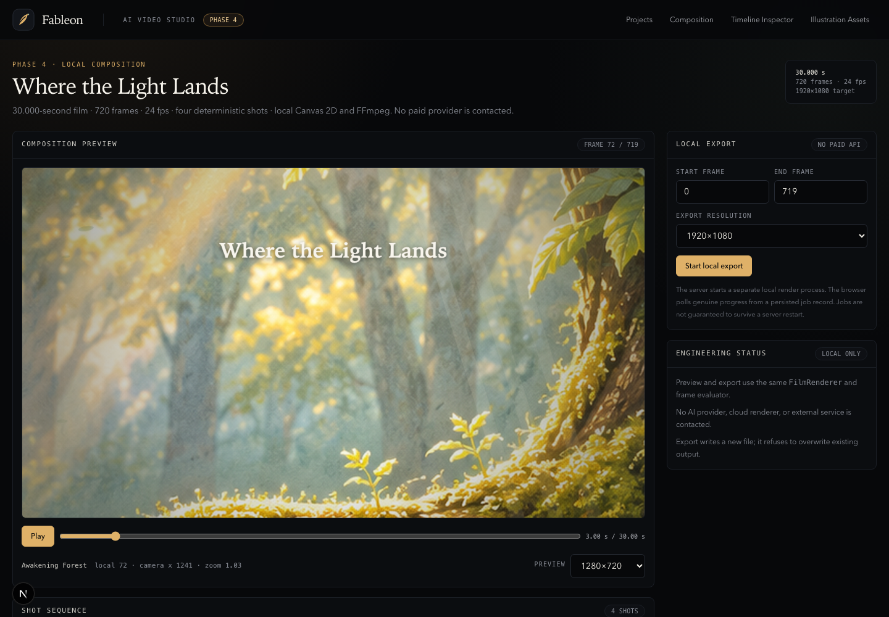
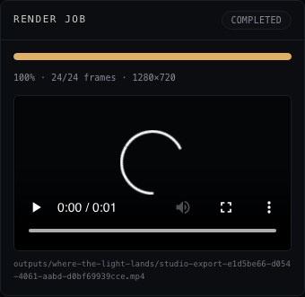

# Phase 4 Report — Zero-API-Cost Animation Engine & 30-Second Story

- **Phase:** 4 — Local composition, motion, camera, and offline film export
- **Date:** 2026-11-10
- **Branch:** `main`
- **Starting HEAD:** `3fc53015530f911bb1c77fbf3865f6cbc6a21b02`
- **Final implementation HEAD before this report:** `38b6ff03501b102a1ac932002c5f80d48c66963b`
- **Report commit:** the commit containing this report
- **Paid API calls:** **0**
- **Remote push:** **None**
- **Phase 5:** **Not started**

## A. Executive Summary

Fableon can now produce a complete **30.000-second, 1920×1080, 24 fps MP4** entirely
locally.

The film **Where the Light Lands** contains four deterministic shots:

1. Awakening Forest
2. Little Bird in Flight
3. The Landing
4. A Place to Rest

It uses the existing nine-part Little Bird rig, a reusable motion-preset package, a
deterministic cinematic camera, a conservative two-plane parallax environment, seeded
ambient effects, explicit transitions and titles, and a single Canvas 2D renderer shared by
the Studio preview and the offline exporter. Chromium rasterizes frames; FFmpeg encodes the
MP4. No paid image/video provider or cloud renderer is contacted.

The final MP4 was decoded end to end and verified:

```text
Path: outputs/where-the-light-lands/final.mp4
Duration: 30.000 s
Frames: 720
FPS: 24
Resolution: 1920×1080
Codec: H.264
Audio: none
Decode check: PASS (exit 0)
SHA-256: 61ef10891b96d09eeb06d88bf8bcd9b2477b30514ff87b9d5e64a8e8ea88bf62
```

Artistic quality is **not self-certified**. The character remains candidate artwork with
visible cutout seams and fringing. The film is an engineering-complete local production
milestone and a reviewable storybook animatic, not production-ready illustration.

## B. Repository State

- **Starting branch:** `main`
- **Starting working tree:** clean
- **Starting HEAD:** `3fc5301` — Phase 3 completion report
- **Final implementation HEAD before report:** `38b6ff0`
- **Final report commit:** this commit
- **Working tree after the report:** clean

All Phase 0–3 systems remain present:

- `/` homepage
- `/studio` deterministic timeline inspector
- `/studio/assets` illustration preparation workspace
- `/studio/projects` and Phase 3 shot/review workspace
- all Phase 2, 2.5, 2.6, and 2.7 Gate 2 benchmark routes
- historical benchmark artifacts and project data

No scene-schema contract was replaced. No historical benchmark media was modified.

## C. Feature Implementation

| Feature                    | Commit                                                                                 | Implementation                                                                                                                                   | Tests / acceptance                                                                                                           |
| -------------------------- | -------------------------------------------------------------------------------------- | ------------------------------------------------------------------------------------------------------------------------------------------------ | ---------------------------------------------------------------------------------------------------------------------------- |
| 4.1 Multi-shot timeline    | `571a62837b33d403763e1c8fb99efb1c18ae0759`                                             | `packages/composition-core`: contiguous shot validation, global/local frame mapping, 720-frame timeline, explicit transitions, title evaluation  | 7 tests: boundaries 0/143/144/359/360/527/528/719, invalid frames, determinism, immutability, transition and title semantics |
| 4.2 Camera engine          | `caf81cb91005d129dbde792cc6a567533fb205ea`                                             | `packages/camera-engine`: pan/zoom/target, bounds clamping, easing, world/screen transforms, parallax matrices                                   | 5 tests: interpolation, bounds, transforms, relative depth movement, determinism                                             |
| 4.3 Layered parallax       | `4bea2059e7a937fc55a7befdfd8f32a11b8cf89e`                                             | `apps/web/lib/film/environment.ts`: two-plane environment contract and camera-space layer transforms                                             | 2 tests: layer ordering and relative movement                                                                                |
| 4.4 Reusable motion        | `20486bbae431dc6776a9c79e9bd5a42a08553cd3`                                             | `packages/character-motion`: nine-part base rig, flight/glide/landing/idle presets, exact foot-contact solver                                    | 8 tests: rig, wing articulation, path, contact stability, reuse, idle blink, determinism, no mutation                        |
| 4.5 Ambient forest         | `3c2d38d425c2f77120b8a2547fd2daab7c5cbcb1`                                             | `apps/web/lib/film/ambient.ts`: seeded pollen, leaves, sunlight and mist evaluated from absolute frames                                          | 2 tests: direct-frame stability and seed determinism                                                                         |
| 4.6 Transitions and titles | `f3f73b97a491606414fd5732e7bc5750a2681628`                                             | Title wrapping/layout and explicit composition transition semantics                                                                              | 3 title layout tests plus 7 composition timeline tests                                                                       |
| 4.7 Offline export         | `f63575cc3a74fcabb353048a3217e672dc0715fd`                                             | Shared `FilmRenderer`, four-shot spec, Chromium frame rasterization, FFmpeg image2pipe encode, ffprobe/decode verification, artifacts, manifests | Checkpoint 5 s and full 30 s renders; 720 frames decoded; 1920×1080/24 fps/30.000 s verified                                 |
| 4.8 Studio composition     | `fc052785fac1700013b642afd3389a9e019dc45c`                                             | `/studio/composition` Canvas preview, shot navigation, scrub/play, resolution selector, export controls, job polling/cancel/video service        | Browser tests: load, four shots, boundaries, camera/wing/contact/title state, real 24-frame export and playable result       |
| Studio fixes               | `2df14cc8ca419f158e3e6c1fc1b9f25eca466a1f`, `0fab3e4fd84a46acd02a94a688f2c12fa71a4a67` | Exposed frame/camera state, Phase 4 label, local-server reuse                                                                                    | Covered by Phase 4 browser tests                                                                                             |
| 4.9 Demo story artifacts   | `01964b0a7fa9e2af51a2cd799fbf5b762a2d79e2`                                             | Storyboard, shot specification, provenance, quality assessment, selected frames, contact sheet, timeline diagram, performance/manifest copies    | All files verified on disk; final MP4 rendered and inspected                                                                 |
| Formatting                 | `5e1ce60669562d3f5403515db6f040d7c1a83bfe`                                             | Prettier formatting for benchmark documents                                                                                                      | `format:check` pass                                                                                                          |
| 4.10 Regression tests      | `057a4d72b81a63d0b87c76ead5bf42a8bdc769d7`                                             | Phase 4 browser suite, composition route regression, stable phase-02 route assertion                                                             | 51 browser tests pass; 247 unit tests pass                                                                                   |
| Documentation              | `38b6ff03501b102a1ac932002c5f80d48c66963b`                                             | README and architecture update for the film pipeline                                                                                             | Documentation-only verification                                                                                              |

## D. Architecture

### Composition manifest

`packages/composition-core` defines a film as ordered shots with integer start frames,
frame counts, camera track IDs, character motion IDs, rendering method, transition-in,
optional transition-out, and notes. It is additive and separate from the versioned
Phase 1 scene schema and Phase 3 Studio project model.

### Timeline

`evaluateCompositionFrame(composition, globalFrame)` validates the entire composition and
returns:

- global frame;
- shot and shot index;
- local frame;
- previous shot/local frame during a crossfade;
- incoming/previous/black opacity;
- active titles with opacity.

Crossfades hold the previous shot's last frame for the first 12 frames of the incoming shot
without changing the 720-frame output length. Fade-from-black and fade-to-black are also
within the global frame budget.

### Camera

`packages/camera-engine` samples keyframed camera centers, zoom, and rotation with easing.
It clamps the viewport inside the 2400×1350 world, exposes world/screen transforms, and
provides depth-aware layer matrices. The camera is independent of the character rig.

### Parallax

The available source artwork is one painted forest plate derived from the Phase 2.8 start
frame. The implementation is deliberately conservative:

- a softened distant copy at depth 0.18;
- the primary painted plate at depth 0.55;
- screen-space light, mist, pollen, and leaf sway.

This is documented as a two-plane approximation, not a repainted multilayer forest.

### Motion

`packages/character-motion` defines the reusable nine-part Little Bird base rig and four
presets. It uses `@fableon/sprite-motion` hierarchy evaluation. The landing preset solves
the body Y position so the lower foot is exactly at the branch world Y, preserving the
contact guarantee. The historical Phase 2.5/2.7 benchmarks are untouched.

### Ambient effects

Ambient state is a pure function of absolute global frame and seed. Particles, leaves,
sunlight, and mist do not accumulate state. Direct frame 400 evaluation is identical to
repeated evaluation.

### Renderer

`apps/web/lib/film/renderer.ts` is the single Canvas 2D renderer used by:

- `/studio/composition` preview;
- `/studio/composition/render` export surface.

It draws two environment planes, the posed character, atmosphere, titles, crossfades, and
black fades into a canonical 1920×1080 canvas, then scales to the requested 16:9 output.

### Export pipeline

`scripts/render-phase-04.mjs`:

1. starts or reuses a local Next server;
2. loads the render surface in headless Chromium;
3. requests each frame as a PNG data URL;
4. streams PNG frames into local FFmpeg `image2pipe`;
5. encodes H.264 MP4;
6. runs ffprobe, frame-count, duration, resolution, codec, and full-decode checks;
7. writes manifest/report/performance artifacts;
8. records genuine progress to a persisted local job record.

The Studio export API spawns the same script as a detached local process and polls its job
file. It refuses a second active job, supports a cancellation flag, and serves the completed
MP4 with byte-range support. Jobs are not claimed to survive server restarts.

## E. Story Specification

Full documents:

- `docs/benchmarks/phase-04/STORYBOARD.md`
- `docs/benchmarks/phase-04/SHOT_SPECIFICATION.md`

| Shot                      | Frames  | Time    | Camera                            | Character                                                        | Atmosphere / title                                             |
| ------------------------- | ------- | ------- | --------------------------------- | ---------------------------------------------------------------- | -------------------------------------------------------------- |
| 1 — Awakening Forest      | 0–143   | 0–6 s   | Pan right, zoom 1.00→1.06         | none                                                             | Opening title 24–108; fade from black 12f; pollen, mist, light |
| 2 — Little Bird in Flight | 144–359 | 6–15 s  | Follow left→right, zoom 1.02–1.04 | Flight preset, wing beats, tail follow, head stabilization       | 12f crossfade in; layered forest                               |
| 3 — The Landing           | 360–527 | 15–22 s | Settle on branch, zoom 1.04→1.07  | Braking, leg extension, contact at global 470, wing fold, settle | 12f crossfade in; branch contact shadow                        |
| 4 — A Place to Rest       | 528–719 | 22–30 s | Push-in 1.07→1.16                 | Idle breathing, tail/head adjustments, blink                     | 12f crossfade in; ending title 600–688; fade to black 24f      |

The output is exactly 720 frames. The final frame is fully faded to black.

## F. Rendering System

- Canvas 2D, canonical 1920×1080, 24 fps.
- Shared `FilmRenderer` and `evaluateFilmFrame` for preview and export.
- Environment: two derived painted plates plus procedural atmosphere.
- Character: nine-part hierarchical rig, candidate Phase 2.7 parts.
- Titles: deterministic wrapping, fade opacity from composition evaluator.
- Export: Chromium PNG frames → FFmpeg `image2pipe` → H.264 `yuv420p`, CRF 18,
  `+faststart`.
- Source media: local public assets; no remote URL fetching.
- Determinism: integer frame indices, seeded ambient state, no wall-clock or accumulated
  particle state.
- Container bytes are not guaranteed identical across encoder environments; animation state
  and frame order are deterministic.
- Output is Git-ignored; review artifacts are committed.

## G. Studio Integration

Route: `/studio/composition`

Features:

- four-shot sequence cards with durations and frame ranges;
- Canvas preview at 1280×720 or 1920×1080;
- play/pause at 24 fps;
- global frame scrubber with current time;
- current shot/local frame/camera/wing/contact/title state;
- local export range, resolution selector, start action;
- polled genuine progress, cancel request, completed video preview;
- clear error states and local-only/no-paid-API messaging.

Screenshots:





Existing Studio routes remain operational, including `/studio`, `/studio/assets`,
`/studio/projects`, and all Phase 3 shot/review flows.

## H. Generated Artifacts

| Artifact           | Path                                                 | Verification                                                       |
| ------------------ | ---------------------------------------------------- | ------------------------------------------------------------------ |
| Final MP4          | `outputs/where-the-light-lands/final.mp4`            | 720 frames, 30.000 s, 1920×1080, 24 fps, H.264, full decode exit 0 |
| Final MP4 SHA-256  | —                                                    | `61ef10891b96d09eeb06d88bf8bcd9b2477b30514ff87b9d5e64a8e8ea88bf62` |
| Render manifest    | `outputs/where-the-light-lands/render-manifest.json` | Copied to docs evidence                                            |
| Render report      | `outputs/where-the-light-lands/render-report.json`   | Copied to docs evidence                                            |
| Contact sheet      | `docs/benchmarks/phase-04/contact-sheet.png`         | 14 selected frames                                                 |
| Selected frames    | `docs/benchmarks/phase-04/selected-frames/`          | 14 actual rendered frames                                          |
| Storyboard         | `docs/benchmarks/phase-04/STORYBOARD.md`             | Present                                                            |
| Shot specification | `docs/benchmarks/phase-04/SHOT_SPECIFICATION.md`     | Present                                                            |
| Asset provenance   | `docs/benchmarks/phase-04/ASSET_PROVENANCE.md`       | Present                                                            |
| Quality assessment | `docs/benchmarks/phase-04/QUALITY_ASSESSMENT.md`     | Present                                                            |
| Timeline diagram   | `docs/benchmarks/phase-04/timeline-diagram.png`      | Present                                                            |
| Performance data   | `docs/benchmarks/phase-04/performance.json`          | Present                                                            |
| Manifest copy      | `docs/benchmarks/phase-04/render-manifest.json`      | Present                                                            |
| Report copy        | `docs/benchmarks/phase-04/render-report.json`        | Present                                                            |

The selected frames were saved at 960×540 for review. The final video is the canonical
1920×1080 artifact and remains in the Git-ignored output directory.

## I. Tests & Verification

| Check                 | Result                                                  |
| --------------------- | ------------------------------------------------------- |
| `pnpm install`        | PASS                                                    |
| `pnpm format:check`   | PASS                                                    |
| `pnpm lint`           | PASS                                                    |
| `pnpm typecheck`      | PASS                                                    |
| `pnpm test`           | PASS — **34 files, 247 tests**                          |
| `pnpm build`          | PASS — 12 routes/pages, no build warnings               |
| `pnpm test:browser`   | PASS — **51/51 tests**                                  |
| 5 s checkpoint render | PASS — 120 frames, 5.000 s, 1280×720                    |
| Full film render      | PASS — 720 frames, 30.000 s, 1920×1080                  |
| Final FFprobe         | PASS — H.264, 1920×1080, 24/1, 720 frames, 30.000 s     |
| Full decode           | PASS — `ffmpeg -f null -` exit 0                        |
| Audio                 | Absent, as intended                                     |
| Studio export job     | PASS — 24-frame 1280×720 job completed and video played |
| Existing routes       | PASS — homepage, Studio, assets, projects, benchmarks   |
| Paid API calls        | **ZERO**                                                |

Browser coverage includes:

- composition route load;
- four-shot sequence;
- exact boundary scrubbing;
- real Canvas pixel changes;
- camera movement;
- wing articulation;
- foot contact at global frame 470;
- ending title and final black;
- real export initiation, progress, completed video playback;
- all existing routes and Phase 3 workflows.

## J. Performance

Full 1920×1080 render on the current Apple M1 / 8 GB machine:

| Metric                    |                        Value |
| ------------------------- | ---------------------------: |
| First-frame render        |                     113.4 ms |
| Median frame render       |                     246.1 ms |
| p95 frame render          |                     325.1 ms |
| Total frame rasterization |        181,089 ms (~3.0 min) |
| FFmpeg encoding           |                     1,043 ms |
| Total wall time           |        182,132 ms (~3.0 min) |
| Output size               | 15,419,466 bytes (~14.7 MiB) |
| Rendered frames           |                          720 |
| Audio                     |                         None |

The 1280×720 5-second checkpoint rendered 120 frames in ~21.7 s wall time with a 168 ms
median frame time. Offline export is intentionally not real-time; correctness and stable
output take priority.

## K. Known Limitations

1. **Character artwork is candidate quality.** Visible head/body seams, wing-root halos,
   white fringe, and low-resolution feather edges remain.
2. **Environment plate is soft.** It is an upscaled 852×479 crop from the Phase 2.8 start
   frame, not a native 1080p painting. Parallax uses two derived planes, not a true
   multilayer repaint.
3. **Motion is sprite articulation.** Wings, head, tail, and legs rotate as hierarchical
   cutout pieces. There is no feather deformation, skeletal mesh, IK, or soft-body settle.
4. **Landing is mathematically exact but visually stiff.** The foot-contact solver meets
   the branch height precisely; the surrounding body/feather deformation is limited.
5. **Shot 1 is intentionally slow.** The camera reveal may feel static to some viewers.
6. **Crossfade rule is explicit but simple.** The outgoing shot is held on its last frame
   for the 12-frame crossfade; the first frame of the incoming shot is an overlay, not a
   fully independent scene frame.
7. **No audio.** The film is silent. Narration/music are outside Phase 4.
8. **Local-only Studio export.** Render jobs require a persistent local server; jobs are not
   claimed to survive server restarts.
9. **Full renders take minutes.** A 30 s 1080p render takes about three minutes on this
   machine. Preview and checkpoint workflows are faster.
10. **No automatic output cleanup.** `outputs/` is user-managed and Git-ignored.
11. **No project backup/export.** The Phase 3 local data boundary remains.
12. **No production deployment.** There is no authentication boundary for the write/export
    APIs.

## L. Final Gate Decisions

| Gate                    | Decision                |
| ----------------------- | ----------------------- |
| Engineering             | **GO**                  |
| 30-second film rendered | **YES**                 |
| Offline rendering       | **PASS**                |
| Studio preview          | **PASS**                |
| MP4 export              | **PASS**                |
| Artistic quality        | **PENDING USER REVIEW** |
| Production readiness    | **NOT READY**           |

The engineering gate is met with actual footage. The artistic gate is not self-certified:
the film is a complete local pipeline demonstration with known candidate-art limitations.

## M. Phase 5 Recommendation

Do not begin Phase 5 automatically.

Based on the actual result, the highest-impact next phase is **approved character and
environment artwork at native production resolution**, not more animation infrastructure.
The current motion/camera/timeline systems are functional; the limiting factor is the
candidate bird parts and the upscaled forest plate.

A focused next phase should:

1. Replace the nine candidate bird parts with approved, higher-resolution painted parts.
2. Produce a native 1920×1080 (or larger) forest plate with real separable depth layers.
3. Re-run the same film specification and offline exporter to measure visual improvement
   without changing the pipeline.
4. Add audio only after the visual assets are accepted.

This is a recommendation, not an authorization to start Phase 5.

## Repository and Commit History

```text
571a62837b33d403763e1c8fb99efb1c18ae0759 feat(composition): implement deterministic multi-shot timeline
caf81cb91005d129dbde792cc6a567533fb205ea feat(camera): add deterministic cinematic camera transforms
20486bbae431dc6776a9c79e9bd5a42a08553cd3 feat(motion): create reusable character animation presets
4bea2059e7a937fc55a7befdfd8f32a11b8cf89e feat(environment): add layered parallax rendering
3c2d38d425c2f77120b8a2547fd2daab7c5cbcb1 feat(environment): add deterministic ambient forest animation
f3f73b97a491606414fd5732e7bc5750a2681628 feat(composition): add scene transitions and story titles
f63575cc3a74fcabb353048a3217e672dc0715fd feat(export): implement offline animated video rendering
fc052785fac1700013b642afd3389a9e019dc45c feat(studio): add multi-shot composition preview and export
2df14cc8ca419f158e3e6c1fc1b9f25eca466a1f fix(studio): expose composition frame state and phase label
0fab3e4fd84a46acd02a94a688f2c12fa71a4a67 fix(export): reuse available local server
01964b0a7fa9e2af51a2cd799fbf5b762a2d79e2 feat(demo): create complete thirty-second illustrated story
5e1ce60669562d3f5403515db6f040d7c1a83bfe style(docs): format phase 4 benchmark documents
057a4d72b81a63d0b87c76ead5bf42a8bdc769d7 test(composition): validate offline film rendering workflow
38b6ff03501b102a1ac932002c5f80d48c66963b docs(composition): document phase 4 film pipeline
<report> docs(report): record phase 4 completion
```

No push was performed. No Phase 5 work was started.
